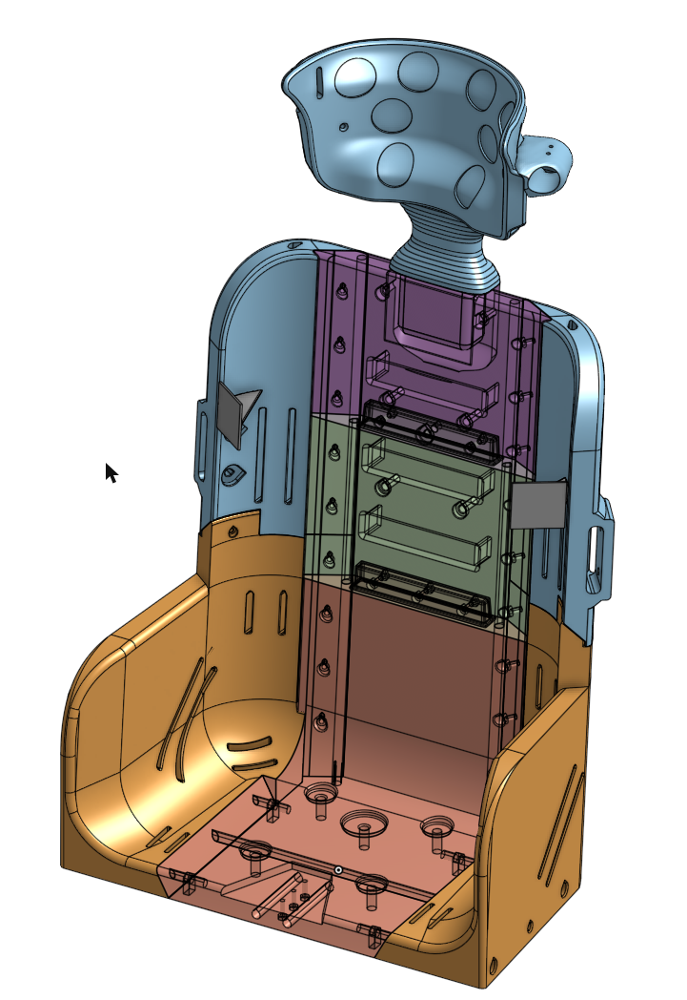

# Headrest (head support) for GbG_chair_forth — v1.1

> ⚠️ **STATUS: PRE-FIRST-PRINT. Work in progress.**
> Nothing here has been printed, load-tested or fitted on a child yet. All fits, weights and strength figures are CAD/slicer/hand estimates.
> Do not use with a child until it has been printed, tested and checked by a PT/OT.

A printed head support for children aged 2–5 with low head control. It mounts in a socket in the chair's backrest. It has an optional pod for the kit's 20 mm PVC head-switch rod and slots for an optional forehead strap (**only if the child's therapist prescribes it**).

## How it works
- **Pad (F3).** One curved shell, 5 mm thick, that cups the back of the head. It has wings above the ears and a soft roll under the occiput. The back thickens smoothly where the joint and the button pocket are, with no added blocks. The head side has 8 shallow pockets for Ø25 mm hook-and-loop (Velcro) dots that hold a 10 mm EVA foam liner.
- **Mast (M1).** One smooth printed stem with two Ø8 mm carbon rods inside it as a backup spine (v1.2: the stem top sits 0.1 mm under the pad, so no feather ridges are left where the pad is cut out of it; 0.5 mm chamfer round the tenon's flush back face). At the top, a tapered curved tenon (K2) slides into a channel in the pad and wedges tight. 2× M3×25 from under the chin (heads in flat spot-faces) lock it; **the shape carries the load, the screws only lock**. The bottom is a 56×26 plug in a 45 mm deep socket in the backrest, locked by 2× M5 from behind.
- **Receiver (chair change, R2).** The chair's `top_back` part is reprinted with the socket. Behind the backrest it is a slim lens, 16 mm deep, that stays inside `top_back` (z ≥ 303; nothing reaches `mid_back` or below 2/3 of the chair's height). **v1.3 (owner decision 2A):** the rods run 10 mm past the plug into two blind Ø8.6 seats in the socket floor (1 mm lead-in, seat bottom z 334, ≥ 3.5 mm wall to the housing's back face), so the mast root is stiffer; the housing shape is unchanged. **v1.2b:** `top_back`'s two side M5 mounts (x ±37.5, z 373.6, bolted from the front through a counterbore) are kept as full holes: their original voids are cut back out after the receiver is added, and a flat Ø11 seat for the washer and nut is cleared through the housing behind them (3.8 mm wall to the socket). The centre M5 mount (x 0, z 373.6) lies inside the socket and is lost. **Owner decision 1A (2026-11-17):** the car fitting uses the 4 remaining M5s (x ±37.5 z 373.4, x ±30 z 296); no replacement hole.
- **Button pod (W1).** A smooth pod that sits on the pad side. Its wedge clicks into an 8 mm triangle pocket and carries the load. **v1.2b, screws flipped (owner): 2× M3×20 go in from the pad's HEAD side** (heads countersunk in the shell under the foam liner) and out through the pad into hex nuts in pockets in the pod, open to the outside, so a screw that is too long can only point away from the head. To take the pod off, lift the Velcro-held liner. **v1.2:** the 20 mm PVC rod slides into a Ø20.8 bore and is locked by **3 small self-tapping screws** (ST3.5 × 6.5 pan head) through Ø4 holes at the top, the outward side and 50° below the side, half-way down the bore, each on a flat Ø8 seat (the v1.1 2× M3×30 through-bolt clamp and its nut traps are gone). No sharp edges: collar ends rounded r2, band edge rounded r2, underside lifted 1.3 mm with a 45° step-chamfer outside the footprint, bore mouth and every hole mouth chamfered. Angles 12°, 20° or 28° toward the outside. The final switch position and angle are the therapist's call at fitting. A **blank** (1× M3×12 from the head side into a nut in the blank) plugs an unused pocket; v1.2 gives it a 1.5 mm cover flange (top edge rounded) lying on the pad's back that also hides the pocket rim and the two unused pod-screw holes.
- **Heights.** One pad, five masts: H0/H25/H50/H75/H100 (pad centre 431–531 mm above the seat). The relief window in the stem appears only where the stem is long enough (H100).

## Parts and print data (real Bambu Studio slices, P1S, PETG, 0.2 mm, tree supports on the plate)
| Part | File (`stl/`) | Print orientation (already in the file) | Walls / infill | Time | PETG |
|---|---|---|---|---|---|
| Pad F3 | `headrest_pad_F3.stl` | **upside down** | 4 / 20 % gyroid | 5.4 h | 172 g |
| Mast H0 / H25 / H50 / H75 / H100 | `headrest_mast_H000…H100.stl` | **on its side** | 6 / 40 % gyroid | 4.3 / 5.1 / 5.9 / 6.6 / 7.3 h | 120 / 147 / 171 / 192 / 207 g |
| Button pod, yaw 12/20/28, right + left | `headrest_button_pod_yaw*_{right,left}.stl` (**v1.2, exported from the Python reference**; re-export from Onshape before the first print) | **lying on its pad-side underside** | 4 / 40 % | ~1.5–1.7 h (v1.1 slice) | 30–36 cm³ |
| Pocket blank, right + left | `headrest_pocket_blank_*.stl` (still v1.1: no cover flange yet) | wedge down (v1.2: support under the flange, a hidden face) | 4 / 40 % | ~15 min | ~5 g |
| Fit-test bar (**print first**) | `headrest_fit_test.stl` (v1.2: brackets the new tolerance block) | flat | 3 / 20 % | 1.4 h | 44 g |
| Chair `top_back` with receiver | `chair_top_back_with_headrest_receiver.stl` | chair coordinates: print upright (top edge up) | 4+ walls round the socket | – | – |
| Foam template part | `padding/foam_template_part_2mm.stl` | flat | 2 / 15 % | 1.3 h | 44 g |
| Rod cutting gauge, base (workshop tool) | `stl/tools/rod_cutting_gauge_base.stl` | flat, as exported, no supports | 3 / 15 % | 2.2 h | 70 g |
| Rod cutting gauge, clamp lid | `stl/tools/rod_cutting_gauge_lid.stl` | flat, countersinks up | 3 / 15 % | 0.25 h | 7 g |

One headrest (pad + H50 mast + 1 pod + 1 blank) is about **378 g of PETG and 13 h**. Why these orientations: see [`PRINT_GUIDE.md`](PRINT_GUIDE.md) §3.

## Strength (hand beam model on the real sections, solid PETG E 1.9 GPa / 40 MPa, carbon EI added; untested)
300 N knock at the pad, 150 N push, 250 N side bash:

| Mast | Knock SF (plastic) | Side SF | Push flex at the pad | Carbon rods alone, SF | Socket wall pressure |
|---|---|---|---|---|---|
| H0 | 10.5 | 14.5 | 0.02 mm | 8.4 | 0.9 MPa |
| H25 | 7.4 | 11.0 | 0.14 mm | 5.9 | 1.3 MPa |
| H50 | 5.7 | 8.9 | 0.34 mm | 4.6 | 1.7 MPa |
| H75 | 4.6 | 7.5 | 0.69 mm | 3.7 | 2.1 MPa |
| H100 | 3.9 | 6.4 | 1.49 mm | 3.1 | 2.5 MPa |

These are for a solid section. With 6 walls and 40 % infill expect roughly 70–80 % of this, which is why H100 must pass the load test before use.

## Fits and tolerances (the TOLERANCE BLOCK at the top of `featurescript/gbg_headrest_v10.fs` = `generator/headrest_FITS.py`)
P1S/PETG policy (v1.2): FDM holes print 0.1–0.3 mm undersize (horizontal ones worse, teardrops too), so **clearance holes +0.4–0.5 on the diameter, nut traps AF +0.3 and nut thickness +0.4 deep, sliding fits ≥ 0.2 per side, rod and PVC bores slip fits** (something else locks them).

| Fit | Value | Policy | Check with |
|---|---|---|---|
| Ø8 carbon rod in the mast | **Ø8.5** teardrop bore (was 8.3; rods are often 8.0–8.1), 87 + H long, open at the plug end | slip | fit-test bar Ø8.3/8.5/8.7 |
| Ø8 rod end in the chair socket floor (v1.3) | **Ø8.6** vertical blind seat, 11 deep (1 mm spare under the rod), 1 mm lead-in | slip; the plug aligns it | ream with an 8.5 drill if tight |
| PVC bore in the pod | **Ø20.8** flat-roofed teardrop (was 20.3 = a press fit on 20.0 +0.2/−0 pipe), 3 screws lock it | slip | fit-test rings 20.6/20.8/21.0 |
| Plug in the chair socket | 0.2 mm per side (`SOCK_CL`), 1 mm × 45° lead-in at the mouth | meets ≥ 0.2 (exactly) | first print |
| K2 tenon in the pad channel, column in the pad | 0.25 mm per side (`CH_CL`), 3° taper (wedges tight) | meets | first print |
| Triangle pocket / pod wedge | +0.15 / −0.05 = 0.2 mm per side (`TRI_CL`), 8 mm deep, 2 click dimples, 0.5 mm lead-in chamfer on the wedge | meets ≥ 0.2 (exactly) | fit-test bar pocket + wedge |
| M3 nut traps / pockets | 5.8 across flats (nut 5.5 × 2.4), corner toward print-up. Tenon slots **2.8 deep**; v1.2b nut pockets in the pod / blank open to the outside, ≥ 1.2 mm plastic under the nut and ≥ 1.2 mm wall round the hex | AF +0.3, depth +0.4 | fit-test bar 5.6/5.8/6.0 × 2.8 |
| M5 nut slots | 8.3 across flats, **4.4 thick** (nut 8.0 × 4.0; was 4.3) | AF +0.3, depth +0.4 | fit-test bar 8.1/8.3/8.5 × 4.4 |
| Clearance holes | **M3 Ø3.5, M5 Ø5.5** (were 3.4 / 5.4), PVC-lock screws Ø4.0 (ST3.5); teardrops when horizontal in print | +0.5 | – |
| Countersinks (DIN 7991) | M3 Ø6.5, M5 Ø10.6; chin screws also get a flat Ø6.6 spot-face | – | – |
| Pod underside to pad surface | 0.3 mm gap on the footprint, 1.3 mm outside it | – | – |

## Hardware (v1.2: M screws DIN 7991 countersunk into hex nuts; the PVC lock is 3 small self-tappers)
| Qty (1 pod + 1 blank) | Item | Where |
|---|---|---|
| 2 | Ø8 mm pultruded carbon rod, **95 + H mm** (95 / 120 / 145 / 170 / 195, see below) | mast spine. Bought, not printed. |
| 2 + 2 nuts | **M5×30** DIN 7991 + M5 nut (DIN 934) | from behind through the receiver (flush) into nuts slid into the plug |
| 2 + 2 nuts | **M3×25** DIN 7991 + M3 nut | under the chin into the tenon nuts (v1.1: M3×30, whose tip broke out of the tenon back) |
| 2 + 2 nuts | **M3×20** DIN 7991 + M3 nut | pod → pad, **from the pad's head side** (v1.2b). Screw 1 (rear) head 1.0 mm down a Ø6.6 spot-face, screw 2 head 0.2 mm below flush; nut on a pocket floor in the pod (1.2 / 1.6 mm plastic under it), tip 0.7 mm past the nut; a screw that is too long still ends inside the pocket by 2.3–3.2 mm (screw 1) / 1.4–1.7 mm (screw 2), depending on the yaw |
| 1 + 1 nut | **M3×12** DIN 7991 + M3 nut | blank → pad, **from the pad's head side** (head 0.2 mm below flush, 5.6 mm of pad under it); nut on a pocket floor in the blank (1.3 mm under it), tip 0.7 mm past the nut and 5.4 mm under the flange top |
| 3 | **ST3.5 × 6.5 pan-head self-tapping screw** (DIN 7981 C / ISO 7049, or a 3.5 × 6–8 pan-head wood screw) | PVC lock, through the pod's Ø4 holes into the PVC wall (drill a Ø2.5 pilot ~5 mm deep from the seat first). Pins the pipe against turning and sliding; it is not rated to resist a hard pull-out. Tip ends ~2 mm inside the pipe (pipe wall 1.5 assumed): route the switch cable along the pad side of the pipe. **Not longer than 8 mm.** |
| – | 10 mm EVA foam + 8 pairs of Ø25 hook-and-loop dots | see [`padding/`](padding/) and [`docs/headrest`](../../../docs/headrest/) |

Per headrest with one pod: 2× M5×30 + 2 M5 nuts, 2× M3×25, 2× M3×20, 1× M3×12, 5 M3 nuts, 3× ST3.5×6.5. With a pod on both sides: 4× M3×20, no M3×12, 6 M3 nuts, 6× ST3.5×6.5. Shopping list: [`docs/headrest/shopping_list.md`](../../../docs/headrest/shopping_list.md). (v1.1 needed 4× M3×30 + 3× M3×16 and 7 M3 nuts for one pod: the PVC clamp's 2 bolts and 2 nuts are gone.) The rod cutting gauge (workshop tool) still uses 2× M3×30 + 2 nuts.

### Rod lengths (carbon, full length, cut by hand)
Each rod runs the full bore and 10 mm on into the chair: **95 + H mm**, so the series is **95 / 120 / 145 / 170 / 195** (one step of 25 mm per mast step; v1.3, was 85 + H). The chair seat has 1 mm spare under the rod end, so a cut within ±1 mm is fine. With the mast out of the chair, the rod ends stand 9 mm out of the plug: round their edges with sandpaper after the CA. Full length is not stronger at the weak point (the socket exit) than the shortest working rod, but it is a little stiffer (H75: 0.71 vs 0.78 mm flex) and leaves no rod tip inside the stem. Without rods the strength roughly halves.

Cut them with the printed **rod cutting gauge** (`stl/tools/`, generator `generator/rod_cutting_gauge.py`, picture `review/rod_cutting_gauge.png`): a V-groove, an end stop, a clamp lid (2× M3×30 + 2 M3 nuts from the same packs) and a saw slot at each length, labelled H0…H100. The slot's near edge is at the rod length, so the piece between the stop and the slot is exactly 95 + H. Seal both cut ends with a drop of thin CA.

Cut plans from one 8×500 rod (≈1 mm per saw cut):
| Rod gives | Pieces | Left over |
|---|---|---|
| H0 pair + H50 pair | 2×95 + 2×145 = 480 | 16 |
| H0 pair + H25 pair | 2×95 + 2×120 = 430 | 66 |
| H75 pair | 2×170 = 340 | 156 (one H0, H25 or H50 rod) |
| H100 pair | 2×195 = 390 | 106 (one H0 rod) |

Other rod materials and borrowed standard parts are being reviewed in [`docs/headrest/rod_options.html`](../../../docs/headrest/rod_options.html). Carbon stays the design until one is approved.

## Files
| Path | What |
|---|---|
| `featurescript/gbg_headrest_v10.fs` | Onshape FeatureScript, fully native B-rep (v1.1). Feature **GbG Headrest v1.1** (height, pod side, pod angle, rods, print layout, review gallery) and feature **GbG Headrest Receiver (chair)**. The pad and the mast stem are built from the same formulas as the Python model (B-spline surfaces); only the pod hull is section data. |
| `stl/` | Parts in print orientation. **The folder currently mixes versions:** the 6 pods and the fit-test bar are **v1.2** (from the Python reference, `headrest_FINAL_export.py pods` / `fit`), while the pad, the 5 masts, the 2 blanks and the chair `top_back` are still **v1.1** (exported from Onshape's geometry, decimated to ≤ 0.02 mm). The v1.1 files lack the v1.2 changes (new tolerance block, blank flange and M3×12 seat, stem drop, strap-slot / tenon edge finishes). The official set is re-exported from Onshape after the owner has inspected the v1.2 FeatureScript there. |
| `padding/` | 1:1 foam template (A4 PDF), the 2 mm template part to trace and mark, and `test_kit/coupon_F3_attach_test.stl`. |
| `review/` | Shape-review evidence: v1.1 pod renders from Onshape, support-by-surface-class study; v1.2 `pod_v12_lock_holes.png` and `pod_v12_odd_lines_before_after.png`. |
| `stl/tools/` | Workshop tools: the rod cutting gauge (base + clamp lid). |
| `generator/` | The Python reference model (manifold3d), plus `rod_cutting_gauge.py`: `headrest_FINAL.py` (all parts + checks), `headrest_POD11.py` (pod + `write_fsdata()` for the FeatureScript), `headrest_MB_strength.py`, `headrest_SURF.py` / `headrest_ORIENT.py` (orientation study), `headrest_REVIEW.py` (Onshape vs reference), `headrest_STL_FROM_ONSHAPE.py`. Needs `numpy manifold3d trimesh scipy`. |
| [`docs/headrest/`](../../../docs/headrest/) | Design-review pages and the padding shopping list. |

## CAD (Onshape)
- Chair doc **GbG_chair_forth**, **Main, version V12 "Main + headrest v1.1 (pre-first-print)"** (branch `headrest-v1` merged 2026-11-16):
  - Feature Studio **GbG Headrest v1.0** (the tab name) = `featurescript/gbg_headrest_v10.fs`.
  - **Part Studio 1**: last feature **GbG Headrest Receiver (chair) 1** (the socket in `top_back`).
  - **Headrest v1.0** Part Studio: the headrest on the chair (H50, right pod, 20°) and the print layout.
  - **Headrest review gallery**: every height, pod angle and side.
  - **Assembly 1**: the chair with the headrest.

## v1.1 review (what was checked, all on Onshape's own geometry)
- Every variant (5 masts, 6 pods, 2 blanks, pad) is exactly one valid closed solid.
- Shape matches the Python reference; the only differences are intended (teardrops, hex traps, screw seats).
- Functional probes: every hole, slot, bore and nut trap is open end to end on every mast, pod and the pad.
- No clash between pad, pod and blank (0.001 mm³).
- Every horizontal hole is a teardrop aimed at its part's print-up; nut traps are corner-up.
- Print orientation chosen by where support touches: none on fit surfaces, as little as possible on visible ones.

## Before this can drop "pre-first-print"
- [ ] Load the v1.2 FeatureScript on an Onshape branch, check it regenerates with **no yellow "Finish skipped" warning** (a fillet, chamfer or lift step that fails is now listed there instead of being skipped silently: pod lift, wedge lead-in, receiver mouth / top edge, blank flange round, strap-slot rims, tenon back chamfer are new B-rep ops), and re-export the whole set (pods, blanks, masts, pad, chair `top_back`) from Onshape.
- [ ] **Body counts, not just feature status:** loading 7d39d8c emptied both Part Studios (0 parts, features OK). Before merging, load this version on a branch and check that Part Studio 1 still has all 9 chair parts and that the headrest feature gives pad, mast, pod, blank and 2 rods.
- [ ] Print the fit-test bar, then set `ROD_HOLE_D`, `NUT_M3_AF`, `NUT_M5_AF`, `TRI_CL`, `PVC_BORE` from the results.
- [ ] Print the chair `top_back` from branch `headrest-v1`, plus an H50 mast, then check the plug in the socket, the bolts and the rods.
- [ ] Print the pad and check the tenon slide-in, the taper wedge and the lock screws.
- [ ] Load tests per mast height: 300 N knock and 250 N side at the pad centre, 150 N push. No cracks, under 3 mm movement. H100 is the critical one.
- [ ] Padding test kit (coupon): dots vs strips vs adhesive EVA, heat-forming, comfort.
- [ ] PT/OT fitting on a real child: height, pod side and angle, foam thickness, and the strap only if prescribed.
- Later: S/L pad sizes (same mounting), and reach adjustment (pad further forward) with the rods.
