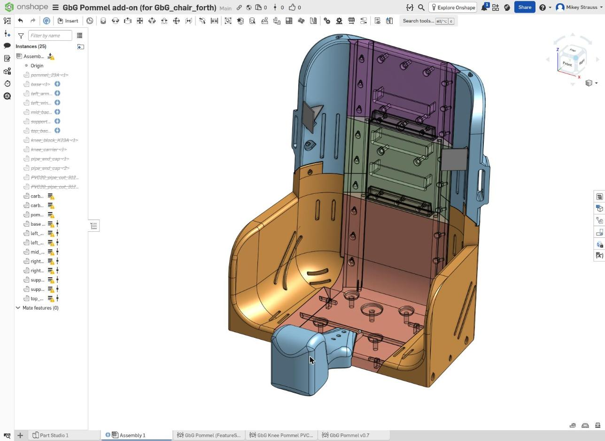

# Pommel (medial knee support) for GbG_chair_forth — v0.7

> ⚠️ **STATUS: PRE-FIRST-PRINT. Work in progress.**
> Nothing here has been printed, load-tested or fitted on a child yet. All fits, weights and strength figures are CAD/hand estimates.
> Do not use with a child until it has been printed, tested and checked by a PT/OT.

A printed pommel that keeps a seated child's knees apart (alignment, or abduction when a PT prescribes it). It bolts to the GbG_chair_forth seat insert and is made for ages 2–5.

## How it works
- **Saddle + hook.** A thin saddle plate sits in a 6 mm recess in the seat, held by the chair's 3 existing M3 screws. A 90° hook wraps down the seat's front face, so pushing down on the pommel presses the hook into the chair instead of levering the screws.
- **Short sizes (S):** one printed part. The knee pad starts at the seat edge.
- **Long sizes (K):** the same saddle, plus a low neck and a knee pad further out. Two Ø6 mm solid carbon rods run from holes in the chair, through the hook and into the pommel.
- **Low over the screws on purpose.** That area is under the child's groin, so the saddle stays 1.5–10 mm above the seat. The tall pad sits at the knees. See the [body measurements reference](../../../docs/pommel/body_measurements_reference.html).
- **Leg-friendly.** Every edge a leg can touch is rounded 10 mm (6.5 mm on K45A).
- **Long sizes:** the neck stays low (1–6 mm above the seat) and 36 mm wide under the thighs. Print it nearly solid for strength; see `PRINT_GUIDE.md` sections 3 and 7.

## Sizes
| Code | Age | Use | Width thigh → knee (mm) | Pad height above seat | Pad position past seat edge | Rods |
|---|---|---|---|---|---|---|
| S23A | 2–3 | alignment | 58 → 70 | 60 | 0–75 | – |
| S23B | 2–3 | abduction (PT only) | 80 → 105 | 60 | 0–75 | – |
| K23A | 2–3 | alignment | 58 → 70 | 65 | 40–110 | 2 × 155 mm |
| K23B | 2–3 | abduction (PT only) | 80 → 105 | 65 | 40–110 | 2 × 155 mm |
| K45A | 4–5 | alignment | 68 → 80 | 78 | 85–155 | 2 × 200 mm |
| K45B | 4–5 | abduction (PT only) | 100 → 125 | 78 | 85–155 | 2 × 200 mm |

The long sizes have a reach adjustment of ±15 or ±30 mm.

## Files
| File | What |
|---|---|
| `featurescript/gbg_pommel_v07.fs` | Onshape FeatureScript: the pommel feature (all sizes, "Print set" layout, rod fit-test bar, built-in snap-off supports). Also contains the chair mount feature. |
| `featurescript/gbg_pommel_mount_chair.fs` | The chair change only: the 6 mm saddle recess and 2 teardrop rod holes. Used on the chair branch. |
| `PRINT_GUIDE.md` | Material (PETG), P1S slicer settings, real and estimated weights, hardware, first-prototype order, strength, assembly. |
| `stl/gbg_pommel_v07_rod_fit_test.stl` | Rod fit-test bar. Print this first (12.9 g, 28 min). |
| `stl/gbg_pommel_v07_S23A_todays_chair.stl` | First prototype: short S23A for a chair without the recess (114 g, 3 h 40 min, with slicer supports). |
| [`docs/pommel/`](../../../docs/pommel/) | Design sketch, body-measurement reference, expert-panel review and background research. |

## CAD (Onshape)
- Pommel: "GbG Pommel add-on (for GbG_chair_forth)", version **v0.7.1 pre-first-print**: https://cad.onshape.com/documents/344bce461e4ccbed87302a1e
  - Part Studio 1 has feature 1 (one size shown on the chair) and feature 2 (print set: all 6 sizes, their supports and the fit test).
  - Assembly 1 shows the pommel on the chair.
- Chair: GbG_chair_forth **Main, version V11**. The `pommel-mount` branch (6 mm saddle recess and 2 teardrop rod holes) is merged into Main.

Only the first-prototype STLs are committed. Export the other sizes from the print set after the fit test confirms the hole sizes.

## Before this can drop "pre-first-print"
- [ ] Print the rod fit-test bar, then set `CHAIR_BORE_D` / `RIB_I` from the results.
- [ ] Print S23A on today's chair ("Chair has recess" off) and check the fit, the hook and the screws.
- [ ] Print the chair seat from branch `pommel-mount` and a long size, then check rod fit and pad flex.
- [ ] Load tests: 300 N down, 200 N sideways at the pad, 150 N up. No cracks, less than 3 mm movement.
- [ ] Add 10–15 mm foam padding, then a PT/OT fit on a real child.
- [x] Real slice for the fit test and S23A (see the print guide).
- [ ] Export and commit the STLs for the other sizes (after the fit test).
